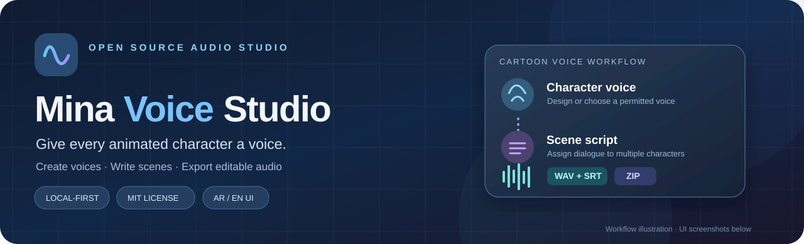
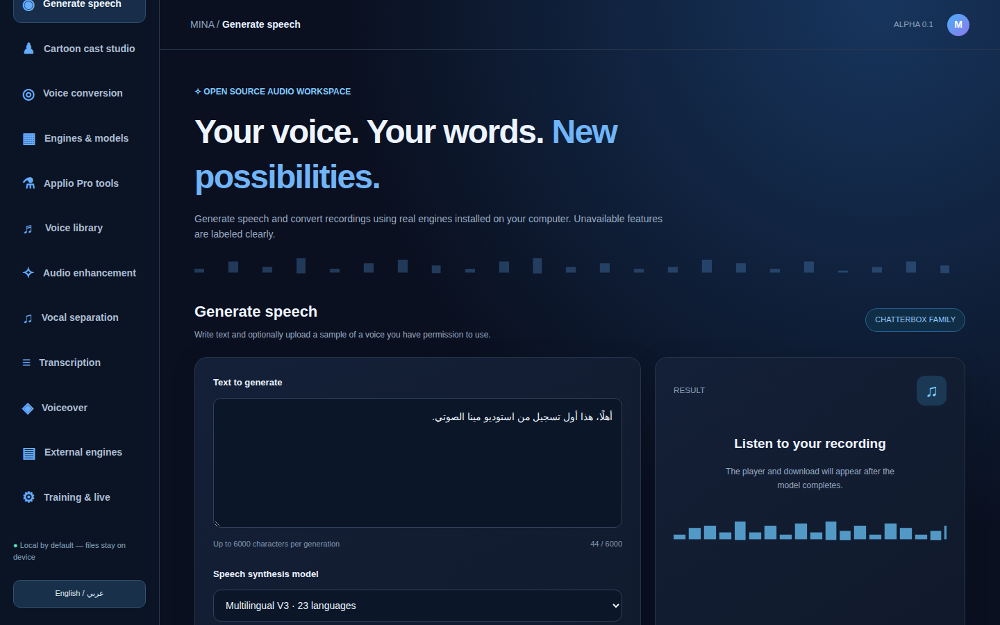
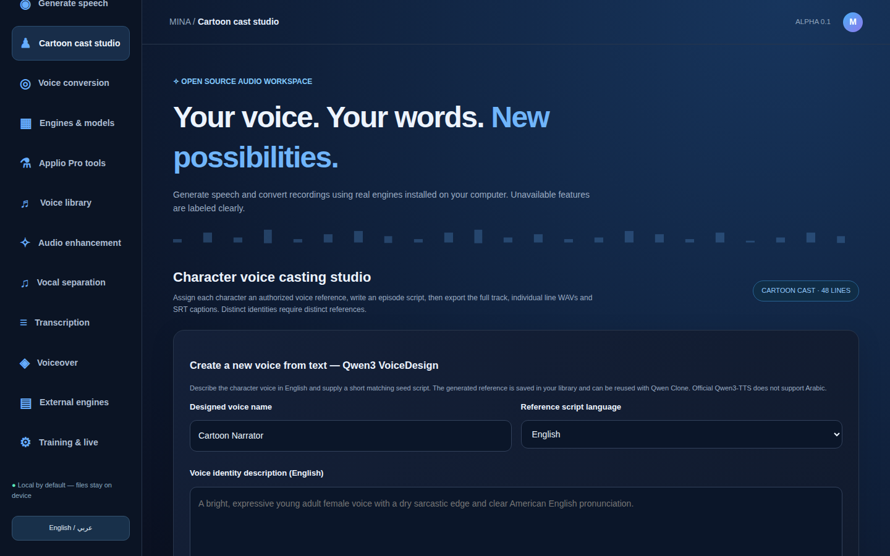
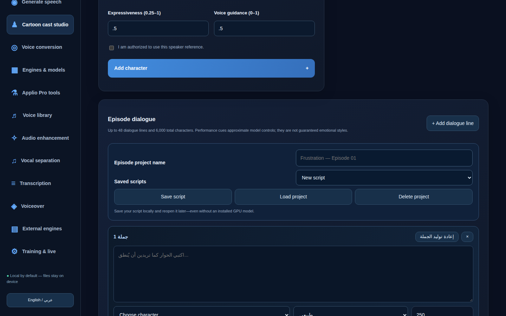
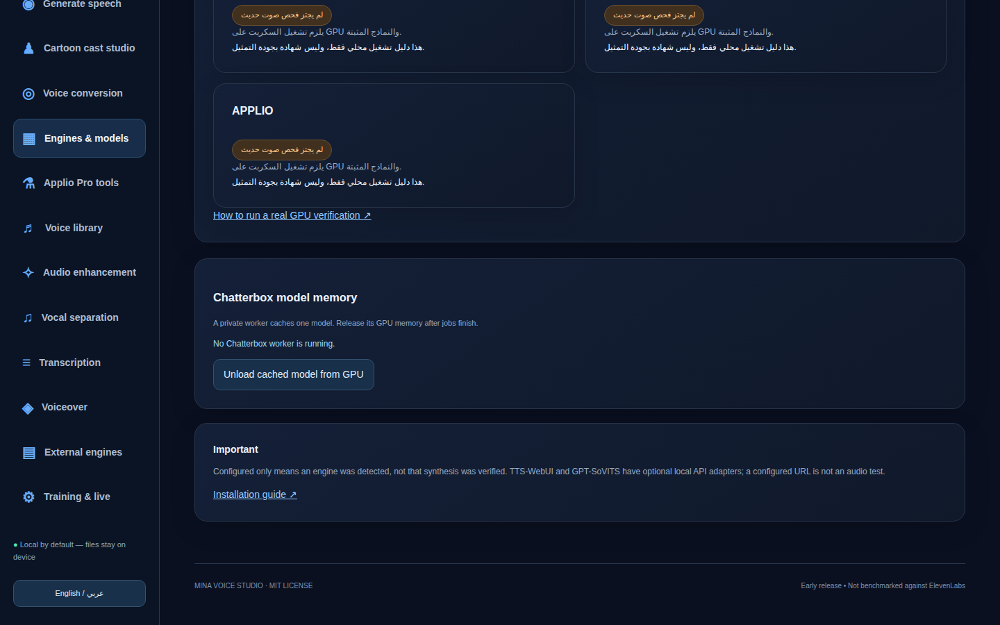
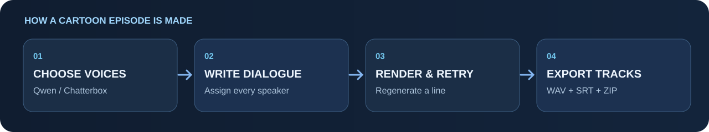

# Mina Voice Studio

**A free, open-source voice workspace for cartoons, games, dubbing and creative projects.**

Design a character voice, write dialogue for multiple characters, generate speech with your own installed AI models, and export audio clips and subtitles for editing.

**بالعربي:** برنامج مفتوح المصدر لصناعة أصوات شخصيات الكرتون وكتابة حواراتها وتحويل التسجيلات وتحسينها. يعمل محليًا على جهازك، ويمكن استعماله بواجهة عربية أو إنجليزية.

[](https://github.com/ahpa5246-lgtm/mina-voice-studio/actions/workflows/tests.yml)
[](LICENSE)
[](https://github.com/ahpa5246-lgtm/mina-voice-studio/releases)

**[Install](#installation) · [See screenshots](#real-app-screenshots) · [Features](#what-can-it-do) · [Built with](#built-with) · [دليل عربي](docs/INSTALL_AR.md) · [Releases](https://github.com/ahpa5246-lgtm/mina-voice-studio/releases)**

> **Alpha release:** The app and interface are open source and free to use. The **AI engines and model weights are separate downloads** and can need an NVIDIA GPU. Simply opening the website does not generate sound until a supported voice engine is configured. This is a **local app**, not a hosted online demo or a production multi-user service.

## Real app screenshots

These four images were captured from the **running Mina application in Chromium** using [a reproducible Playwright script](scripts/capture_readme_screenshots.py), with no visual mockups or neural audio claims. They show the UI with optional AI models *not installed* in the capture environment.

| Generate speech | Cartoon Cast Studio |
| :---: | :---: |
|  |  |
| **Saved scene scripts** | **Engines and verification status** |
|  |  |

## What can it do?

- **Invent a voice:** Use **Qwen3 VoiceDesign** to describe an original English-speaking cartoon character and create a reusable voice seed.
- **Keep characters consistent:** Use **Qwen3 Base** to clone a synthetic or consent-authorized reference voice across dialogue lines. **Qwen3 CustomVoice** offers expressive *preset* voices.
- **Generate multilingual speech:** Connect **Chatterbox Multilingual** (including Arabic) or its English Turbo/Nano options.
- **Produce cartoon dialogue:** Create character profiles, assign speakers to lines, control pauses, save episode scripts and export **WAV, SRT and ZIP**. Regenerate just **one line** without replacing the original episode.
- **Convert a recording:** Connect **Applio / RVC** to change the timbre of licensed recordings, with its own compatible voice model.
- **Clean and analyze audio:** Normalization, filters, noise gate, signal measurements and high-quality **SoXR** sample-rate conversion.
- **More audio tools:** **Faster-Whisper** transcription, **Demucs** vocal/music separation, a voice library, optional speaker-similarity reports and local provider connectors.



**Not included:** automatic lip-sync, video editing, a multitrack timeline, or an unrestricted cloud-hosted GPU service. Voice references require permission from their owners.

## Installation

**You need:** [Git](https://git-scm.com/downloads) and **Python 3.11** for the web app. Actual AI speech synthesis requires installing a separate model environment (see below).

### Windows (PowerShell)

```powershell
git clone https://github.com/ahpa5246-lgtm/mina-voice-studio.git
cd mina-voice-studio
.\start.ps1
```

The startup script creates the local server environment and installs its basic Python dependencies. Then open **http://127.0.0.1:7860**.

If PowerShell restricts scripts, use the [manual Windows setup](docs/INSTALL_AR.md) instead.

### Linux / macOS

Install Python 3.11 and Git first:

```bash
git clone https://github.com/ahpa5246-lgtm/mina-voice-studio.git
cd mina-voice-studio
bash start.sh
```

Then open **http://127.0.0.1:7860**.

### Enable real AI voices

The commands above launch the **interface**. To generate speech, install at least one original upstream engine and its weights; each runs in a **separate environment** to avoid PyTorch dependency conflicts.

For example, on Windows with Python 3.12 installed, prepare Qwen:

```powershell
py -3.12 scripts/manage_engines.py install qwen
```

Follow the environment-variable instructions printed by the installer, then use the [full English/Arabic engine setup](docs/REAL_AUDIO_TEST_AR.md) for checkpoint downloads, Chatterbox, and Applio. First inference may download multiple gigabytes. Use a voice reference only with permission.

**Quick idea:** Open *Cartoon Cast Studio* → create two characters → write a few dialogue lines → render → listen → export individual WAVs and SRT captions to your video editor.

## Built with

| Technology / open-source project | What we use it for |
| --- | --- |
| **[Python](https://www.python.org/) + [FastAPI](https://fastapi.tiangolo.com/) + Uvicorn** | Local application server and audio job API |
| **HTML, CSS and vanilla JavaScript** | The bilingual browser interface |
| **[Qwen3-TTS](https://github.com/QwenLM/Qwen3-TTS)** | Original-voice design, cloning and preset-speaker speech |
| **[Chatterbox](https://github.com/resemble-ai/chatterbox)** | Multilingual and English text-to-speech |
| **[Applio](https://github.com/IAHispano/Applio) / RVC** | Voice conversion and compatible local model workflows |
| **[Faster-Whisper](https://github.com/SYSTRAN/faster-whisper)** | Speech transcription and intelligibility testing |
| **[Demucs](https://github.com/facebookresearch/demucs)** | Music/vocal stem separation |
| **[NumPy](https://numpy.org/) + [Python-SoXR](https://github.com/dofuuz/python-soxr)** | PCM audio processing and sample-rate conversion |
| **[Resemblyzer](https://github.com/resemble-ai/Resemblyzer)** | Approximate voice-identity similarity checks |
| **[Pytest](https://pytest.org/) + [Playwright](https://playwright.dev/python/) + [Kaggle](https://www.kaggle.com/)** | Automated tests, real browser screenshots and optional GPU evaluations |

**Important licenses:** Mina's original application code uses [MIT](LICENSE). Upstream packages and **downloaded model weights have their own terms**; notably Python-SoXR/libsoxr is LGPL-2.1-or-later. Refer to upstream licenses before redistributing models or commercializing outputs.

## What has been tested?

- GitHub Actions exercises the local API, real PCM audio utilities and Chromium UI on **Python 3.11 / 3.12**. Tests of the application do **not** mean all external AI checkpoints passed inference.
- **Qwen3 was actually run on a Kaggle Tesla T4 GPU** for two English synthetic cartoon voices, six cloned lines and preset acting samples. A small-model ASR check reported **WER 1.85%** and **CER 1.48%** on those test lines. These are **small-sample automatic proxy metrics**, not a general speech-quality guarantee or human acting evaluation.
- The [reproducible notebook](kaggle/cartoon_voices_qwen3.ipynb) and [evaluation guide](docs/EVALUATION.md) explain the experiment. Chatterbox/Applio inference still needs independent acoustic validation.

## Community: help build Mina Voice Studio

Mina Voice Studio was **originally conceived and initiated by Mina Hussein Salman ([@ahpa5246-lgtm](https://github.com/ahpa5246-lgtm))**. This is the canonical project repository; independent contributors receive full credit for their work and upstream open-source licenses are respected.

**New contributors:** [Community handbook (Arabic)](docs/community/00_START_HERE_AR.md) · [Roadmap](docs/community/02_PRODUCT_ROADMAP_AR.md) · [30 scoped tasks](docs/community/03_CONTRIBUTOR_TASK_CATALOG_AR.md) · [8 ready-to-open issues](docs/community/12_READY_TO_POST_ISSUES_AR_EN.md) · [Governance](GOVERNANCE.md) · [Contributor guidelines](CONTRIBUTING.md).

**Project owner launch checklist:** [GitHub setup and credit](docs/community/01_REPOSITORY_SETUP_AND_OWNERSHIP_AR.md) · [Community directory](docs/community/05_COMMUNITY_DIRECTORY_AR.md) · [90-day outreach plan](docs/community/07_90_DAY_LAUNCH_PLAN_AR.md). Please submit reproducible bug reports, tests, accessibility fixes and honest acoustic evaluations. **Stars are welcome but never required** for contribution or support.

## Contribute

Bug reports, audio quality findings, fixes, translations and documentation are welcome. Read [CONTRIBUTING.md](CONTRIBUTING.md) or [open an issue](https://github.com/ahpa5246-lgtm/mina-voice-studio/issues/new/choose). Please do not upload private voice recordings, model weights or access tokens.

**[Full installation guide (Arabic)](docs/INSTALL_AR.md) · [Real audio verification (Arabic)](docs/REAL_AUDIO_TEST_AR.md) · [Security](SECURITY.md)**

---
*Give every character a voice. Keep every take editable.*
